<picture>
  <source media="(prefers-color-scheme: dark)" srcset="assets/header-dark.svg">
  <source media="(prefers-color-scheme: light)" srcset="assets/header-light.svg">
  
</picture>

 

I'm a developer at **[Zoonect](https://www.zoonect.com)**, based in Montecatini Terme, Tuscany. I work between code and design, so a normal week mixes:

- **Apps** with Elixir, Phoenix LiveView and Ash Framework, with Oban and PostgreSQL underneath
- **Websites and landing pages** built with Astro
- **Brand and visuals** in Figma and Blender
- **Social content**: posts, carousels and reels, with AI image and video tools in the loop

<picture>
  <source media="(prefers-color-scheme: dark)" srcset="assets/stack-dark.svg">
  <source media="(prefers-color-scheme: light)" srcset="assets/stack-light.svg">
  
</picture>

Most of my work lives in private repositories at Zoonect.
